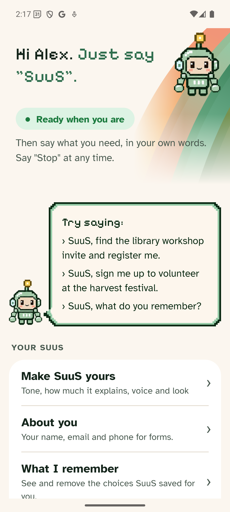
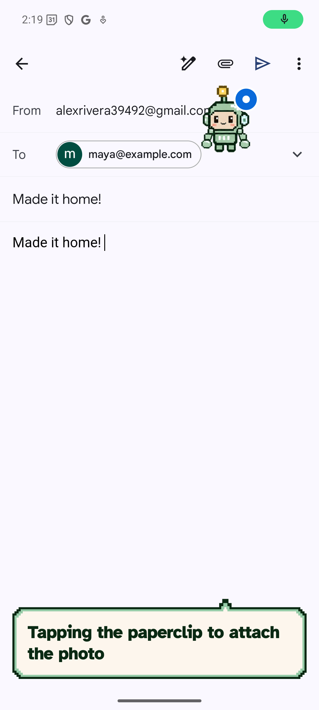

<p align="center">
  
</p>

<h1 align="center">SuuS</h1>

<p align="center">
  <b>Say the goal. SuuS does the taps.</b><br>
  An Android voice agent for people who find small taps and typing painful.
</p>

<p align="center">
  <a href="https://github.com/Nisith-ctrl/icehacks/releases/tag/v1.0"></a>
  
  
  <a href="LICENSE"></a>
</p>

<p align="center">
  <a href="https://suus-nisith.vercel.app"><b>Website</b></a> ·
  <a href="https://github.com/Nisith-ctrl/icehacks/releases/tag/v1.0"><b>Download the APK</b></a> ·
  <b>Demo video</b> <i>(link coming with the Devpost submission)</i> ·
  <a href="docs/"><b>Docs</b></a>
</p>

Say "Suus" and what you need, in your own words. SuuS works through the real apps on your phone
(Gmail, Calendar, Chrome), shows every tap with a little robot, and asks before anything is
submitted or sent. Built in one week for **IceHacks 2026** by a team of four.

<p align="center">
  
  &nbsp;
  
</p>

## The problem

Voice assistants can open an app, then leave you at the hard part: the form, the date picker, the
attachment. That's exactly where the tapping starts. For Alex, our user persona (an active older
adult with arthritis in both hands), each of those tiny taps is the barrier. Talking is easy.

## What it does

- **Register from an invite, hands-free.** "Suus, find the library workshop invite and register me."
  SuuS finds the email in Gmail and opens the registration link. It checks your calendar (one
  session clashes with the dentist, so it picks the other), fills the form and reads it back. Nothing is
  submitted until you say "Submit". It then checks the confirmation page.
- **Works on a form it has never seen.** A volunteer signup with different labels and a new
  question uses the same code. It asks only what it doesn't know and reuses what you told it to
  remember ("Email for event signups").
- **Finish what you started, with selective undo.** In a half-written Gmail draft, "Suus, take over.
  Attach yesterday's dog photo." It asks which photo, attaches it, and "Undo the photo" removes only
  the photo and keeps your words. "Use the one by the door" swaps it, and it sends only after a
  read-back and your spoken "Send".
- **You stay in control.** "Stop" cancels at once. Submit and Send are locked to a fingerprint of
  the exact screen you approved. You choose what it remembers, and can review or delete it by voice
  or on a big-button screen.

## Results (Android emulator, measured from SuuS's run log)

| Task | By hand | With SuuS |
|---|---|---|
| Library workshop registration | 53 touches, 141 s | **0 touches**, 2 spoken commands, 85 s, confirmation LIB-282497 (5 of 5 values verified) |
| Volunteer shift signup | 44 touches, 84 s | **0 touches**, 3 spoken commands, 101 s, confirmation VOL-730060 (6 of 6 values verified) |
| Photo email with undo (Gmail) | not measured | **0 touches**, 6 spoken commands, 124 s, sent |

The saving is in touches, not speed: SuuS's time is mostly waiting on the free AI tier's rate limit.
Details and caveats are in [docs/metrics.md](docs/metrics.md).

## How it works

```
"Suus, sign me up…"  →  voice: wake word, speech to text, the goal
                     →  device: read the screen as a tree of buttons and text (accessibility service)
                     →  agent: an LLM picks ONE next action from the screen and the goal
                     →  overlay: the robot points at the target, with a caption
                     →  device: find it again on a fresh screen, tap or type, wait for the screen to settle
                     →  agent: check the result, repeat until done, a question, or "Submit"/"Send"
```

- **The AI plans, code does the exact parts.** The model only chooses the next step. Filling form
  fields, checking the calendar for clashes, verifying the confirmation page and undo are plain
  code. That makes it more reliable and cheaper: 3–4 model calls to fill a form.
- **Safety:** an app allowlist, forms only on our test site, spoken approval tied to a SHA-256 screen
  fingerprint, never submitting twice, and a 0.1 s "Stop".
- **Modules:** `core` (shared contracts), `device`, `voice`, `agent`, `overlay`, `app`, built in
  parallel against fixed interfaces. More in [docs/hackathon/submission-notes.md](docs/hackathon/submission-notes.md).
- **No key in the APK:** the downloadable app sends its AI requests to a small relay
  ([relay/](relay/)) that holds the Groq key as a server secret and only allows SuuS's two models.

## Try it

**On a phone (Android 11+):** download [SuuS-1.0.apk](https://github.com/Nisith-ctrl/icehacks/releases/latest/download/SuuS-1.0.apk),
open it, and follow the in-app setup (about two minutes). It needs no account or API key. Android
may ask you to "allow restricted settings" before you can turn on the accessibility service
(SuuS's App info → ⋮).

**From source:** you need Android Studio (or JDK 17+ and the Android SDK) and a free
[Groq](https://console.groq.com) API key.

```bash
git clone https://github.com/Nisith-ctrl/icehacks.git && cd icehacks
echo "GROQ_API_KEY=your-key" >> local.properties
./gradlew :app:installDebug     # build and install on a running emulator or phone
./gradlew test                  # JVM unit tests
```

Full steps, the demo seed data and the emulator setup are in [docs/setup.md](docs/setup.md). What
we tested and the limits (emulator only, test data, no MMS on the emulator) are in
[docs/tested-environments.md](docs/tested-environments.md).

## Repository layout

```
icehacks/
├── app/        the Android app: the accessibility service that hosts everything, and SuuS's own screens
├── core/       shared contracts every module builds against (screen model, actions, interfaces)
├── device/     reads the screen and taps, types and scrolls, with checks before and after each action
├── voice/      wake word, speech in and out, spoken approval ("Submit" / "Send")
├── agent/      the planning loop, form filling, calendar and photos, undo, memory, run log
├── overlay/    the robot that points at each control before it's tapped
├── relay/      a tiny Vercel function that holds the AI key, so the APK doesn't
├── site/       the website (static HTML, CSS and JS)
├── fixtures/   test forms, seed data, recorded screens for offline tests
├── scripts/    emulator seeding and demo-recording helpers
└── docs/       setup, metrics, tested environments, and the hackathon write-up
```

Each folder has its own README with the details.

## Built with

Kotlin, Android Accessibility API, SpeechRecognizer and TextToSpeech, Kotlin coroutines,
kotlinx.serialization, OkHttp, AndroidX (AppCompat, SQLite), Gradle; Groq (`openai/gpt-oss-120b`
plans each step, `qwen/qwen3.8-27b` describes photos); Vercel (website, test forms, API relay),
Node.js; HTML, CSS and JavaScript with [Motion](https://motion.dev) for the website.

### AI tools we used (disclosure)

All four of us used **Claude Code** (Anthropic; Claude Opus 5.5 and Claude Fable models) as an AI
coding assistant throughout the week, to write and test much of the Kotlin code, the website and the
docs. Commits it helped with carry a `Co-Authored-By: Claude` trailer. The team designed the
product, the architecture and the safety rules, wrote the task plan, made the decisions recorded in
our notes, tested every demo on the emulator, and reviewed each pull request before merging.
The SuuS robot sprite and its pixel speech-bubble style were generated with **ChatGPT** (OpenAI's
image generation) from Guru's prompts; we cut the sprite sheet into frames and built the overlay
around it. At runtime, SuuS itself uses the Groq-hosted models above.

### Credits

- Fonts: [Atkinson Hyperlegible](https://brailleinstitute.org/freefont) (Braille Institute) and
  [Pixelify Sans](https://fonts.google.com/specimen/Pixelify+Sans) in the app, both under the SIL
  Open Font License (license files in `app/src/main/assets/fonts/`). The website uses Atkinson
  Hyperlegible, Bricolage Grotesque, Instrument Serif and JetBrains Mono from Google Fonts.
- The SuuS robot sprite and pixel speech-bubble artwork: generated with ChatGPT (see the AI
  disclosure above).
- Design references from [Mobbin](https://mobbin.com) (IceHacks sponsor); the app's hero header and
  the website's layout take ideas from stripe.com (inspiration only; no Stripe assets are used).
- The test forms, invite emails and dog photos are fixtures we made (`fixtures/`). No real
  registration happens.

## Team

| | |
|---|---|
| **Nisith** ([@Nisith-ctrl](https://github.com/Nisith-ctrl)) | Team lead: test forms and data, metrics, docs, website |
| **Susmith** ([@srchiluka](https://github.com/srchiluka)) | Agent and device control: screen reading, tapping, voice, the agent loop |
| **Guru** ([@Guru-Balaji18](https://github.com/Guru-Balaji18)) | Design and frontend: the robot, the app's screens, the Gmail photo demo, the APK and relay |
| **Advay** ([@advaycode](https://github.com/advaycode)) | Data: the on-device database, saved preferences and the run log |

How we worked together (shared notes, task files, one branch per task):
[docs/team/workflow.md](docs/team/workflow.md).

## License

[MIT](LICENSE). Bundled fonts keep their own SIL Open Font License.
