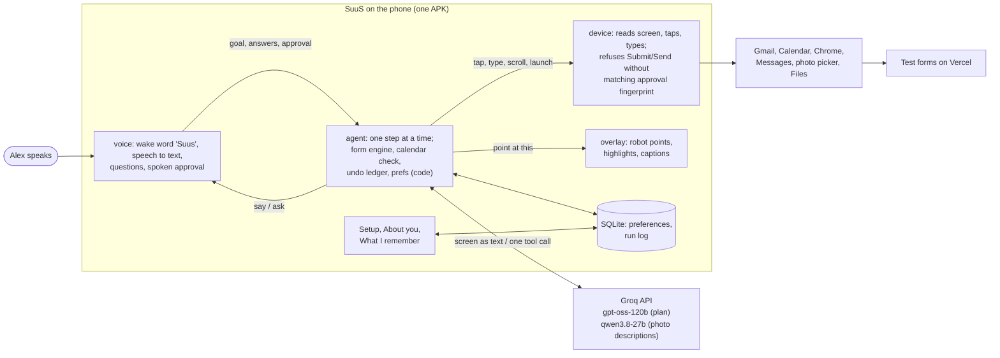

# SuuS submission notes (fact base)

Fact base for the Devpost write-up, the 3-minute video and judging Q&A. Compiled on 2026-11-12 from
the code repo, the PR history (PRs 1 to 31) and the team vault. Every number has a source in
brackets. Where something is untested or uncertain, it says so. Section 14 lists the sources.

Short source keys used below:
- **PR n**: GitHub pull request n on `Nisith-ctrl/icehacks`.
- **metrics**: `docs/metrics.md`. **envs**: `docs/tested-environments.md`. **setup**: `docs/setup.md`.
- **T01 to T06**: task files in `vault/tasks/` (their Handoff sections).
- **groq-api**, **devices**: `vault/team-memory/api-notes/`.
- Decision and dead-end notes are named by their file name in `vault/team-memory/decisions/` and `dead-ends/`.

---

## 1. Summary and tagline

**Tagline (from `docs/devpost.md`):** Say what you need. SuuS shows you every tap, asks before
anything is sent, and undoes just the part you didn't want.

Shorter options: "A voice agent that does the tapping for you." (the Devpost draft's name line)

**Summary.** SuuS (first called "Say the Goal") is an Android app for people who find tapping and
typing hard but can speak comfortably. Our test user is Alex Rivera, an older adult with arthritis
in both hands. Alex says a goal, for example "Suus, sign me up for the library workshop that fits
my calendar." SuuS reads the live screen through an Android AccessibilityService, and a language
model (Groq free tier, `openai/gpt-oss-120b`) picks one action at a time. Code, not the model, does
the parts that must be exact: checking the calendar for clashes, filling form fields, verifying the
confirmation page, and gating Submit/Send. A small robot on screen points at each control before
SuuS uses it and shows a caption. Nothing is submitted or sent until Alex says "Submit" or "Send",
and that approval is tied to a fingerprint of the exact screen that was read back. Alex chooses
what SuuS remembers ("Email. Remember that for event signups."), and can review or delete it. On
the Android emulator, the library registration and a second, differently laid out volunteer form
both ran end to end with zero touches after setup and verified confirmation numbers (LIB-282497 and
VOL-730060) [metrics, PR 27]. The photo hand-off with selective undo runs end to end in a Gmail
draft: attach yesterday's photo, undo only the photo, swap in the other one, read back, send
[PR 35, decision 2026-11-13-demo2-gmail-draft]. Messages was the first plan, but the emulator has no
MMS, so there it only runs up to the attach step [PR 30, dead-end 2026-11-11-emulator-no-mms].

---

## 2. The problem and who it's for

**Alex Rivera** (persona from `vault/team-memory/project-brief.md`): an older adult with arthritis in
both hands. Small taps, typing and picking tiny options are slow and painful; speaking is easy. Alex
is active and independent: signs up for library workshops, volunteers at local events, texts family
to say they got home. Alex wants to do these things themself, see what the phone is doing, fix
mistakes without starting over, and decide what the phone remembers. Alex is the person using the
phone, not a caregiver.

**Why existing voice assistants fall short (team's framing, `docs/devpost.md`):** they can open an
app, but they stop at the part that hurts: the form, the date picker, the attachment. The steps in
between (find the email, open the link, check the calendar, pick the right session, type name,
email and phone, choose a radio option, scroll, press Register) are exactly the small, precise
touches Alex struggles with. Note: the team did not run a formal comparison against a specific
assistant product; this is the design premise, not a measured result.

**What we wanted to be true for Alex (project brief, demo goal):**
- Start a whole task by voice from the home screen, or hand off a task already started.
- See every step (the robot points at the real control first).
- Nothing irreversible without an explicit spoken "Submit"/"Send".
- Undo one specific change without losing the rest of the draft.
- Control what is remembered.

**Persona note:** Alex is a persona. No real users with arthritis tested the app. The test Google
account carries Alex's name [devices, project brief].

---

## 3. What it does (user-visible features)

Each feature: what the user sees, how it works underneath, and where it was built.

### 3.1 Wake word "Suus" and spoken commands
- **User sees:** say "Suus" (said like "soose"), optionally after "hey"/"hi"/"ok", then the request.
  A bare "Suus" makes the robot pop up in Listening mode with "I'm listening…"; it answers "Yes?"
  and returns to idle after 12 s if nothing follows [PR 20, decision 2026-11-10-wake-word-suus].
- **Underneath:** Android `SpeechRecognizer` runs in an always-on loop, paused while text-to-speech
  speaks so SuuS never hears itself [PR 3]. `CommandParser.afterWake` matches the wake word by
  sound: an s/z sound, an "oo" vowel in any common spelling, an s/z ending (suus, sous, Seuss,
  Zeus, zoos, sus, "sue us" joined back…) [PR 13]. The recognizer is biased toward "suus" with
  `EXTRA_BIASING_STRINGS` (API 33+) [PR 13]. Real mishearings ("sis", "cease", "excuse", and nine
  more words) wake it only when said alone [PR 22]. Commands are classified by rules into Goal,
  Take over, Undo, Memory and Stop [PR 3].
- **Chatter filter:** a session lasts 30 s; without the wake word only request-shaped phrases count
  ("open", "find", "undo", "what"…); after a bare "Suus" the next utterance within 10 s is the
  request [PR 19].
- **Built in:** PRs 3, 13, 19, 20, 22.

### 3.2 "Say the goal": multi-app task from the home screen (Demo 1, library workshop)
- **User sees:** "Suus, sign me up for the library workshop that fits my calendar." SuuS opens Gmail,
  finds the invite, opens it, checks Calendar (Thursday's session clashes with a dentist
  appointment, so it picks Friday), taps the link into Chrome, fills the form, reads it back,
  waits for "Submit", submits, and reports the confirmation number [PR 27, T03 Handoff].
- **Underneath:** the agent loop (section 4.2) chooses navigation steps with the model. The calendar
  check is the `check_calendar` tool, which queries `CalendarContract.Instances` for overlap in
  code; the model only supplies the dated options it read from the email [PR 4]. The form is
  filled by the form engine in code [PR 18].
- **Result:** passed on the emulator, LIB-282497, 5 of 5 values verified, 0 touches, 2 spoken
  commands, 12 actions by SuuS, 85 s [metrics, PR 27].
- **Built in:** PRs 1, 4, 9, 15, 18, 24, 25, 27.

### 3.3 Form filling in code (form engine)
- **User sees:** fields fill one after another while the robot points at each.
- **Underneath:** `agent/.../form/` [PR 18]:
  - `FormReader` reads text, radio, dropdown and checkbox fields and the submit button from Chrome's
    accessibility tree.
  - `FormMapper` decides each value's source: the user's profile, the calendar choice, a saved
    preference (only if the form offers that option), or ask the user.
  - `FormFiller` performs checked actions: scrolls, opens dropdowns, looks again at radio groups cut
    off at the fold. It never submits.
  - `ConfirmationCheck` verifies the page after submit (heading, confirmation number, sent values).
- Values are typed with the accessibility API (`ACTION_SET_TEXT`), so no keyboard is used, and the
  keyboard is closed after typing [PR 15, envs].
- **Supported controls:** text, email and phone inputs; radio groups (including ones cut off at the
  fold); checkboxes; `<select>` dropdowns opened and picked in Chrome's native list. Chrome 124 does
  not expose a `<select>`'s chosen value, so the filler remembers its own choice [T03 M3,
  session 2026-11-10-T03-form-engine].
- **Only the goal's form is auto-filled:** one opened from an email link in this run, or one the user
  points at ("take over", "this form"). A form left open from an earlier run is not touched [PR 21, PR 24].
- **Built in:** PRs 18, 21, 24, 31.

### 3.4 Asking questions with choices
- **User sees:** when a required answer is missing, SuuS asks, reads the choices aloud ("You can say
  Setup, Food service, Cleanup or Information desk"), and shows them numbered in the speech bubble.
  A live "You said…" bubble shows what it heard [PR 19, PR 23].
- **Underneath:** `ChoiceMatcher` maps ordinals, names and partial words ("food service" → Food
  serving, "set up" → Setup crew, "yard" → backyard) [PR 3, PR 23, PR 30]. While a question with
  choices is open, only an answer that names a choice (or stop/cancel) counts; room chatter is
  ignored [PR 23]. If the model forgets the choices, they come from the form; the filler opens a
  dropdown once to read its options if needed [PR 23, PR 31]. Answer window: 15 s per try, two
  tries [PR 19].

### 3.5 Spoken approval before Submit/Send
- **User sees:** SuuS highlights the filled fields, reads back event, time and key values, and waits.
  Only the word "Submit" (or "Send") approves; "yes", "sure", "ok" get "Say Submit to send it, or
  Cancel." "Cancel" leaves the form filled and unsent [PR 3, T02 M3].
- **Underneath:** see section 4.4. The approval is the SHA-256 fingerprint of the screen that was
  read back; the device layer re-checks it right before the tap, so any change forces a new
  approval [PR 1, PR 3].
- **Checked live:** Cancel on the live volunteer form left it filled and unsubmitted (2026-11-10)
  [T02 M3]. "Approval invalidated when the draft changed" is covered by unit tests
  (`DraftApprovalTest`), not by a live run [PR 25].

### 3.6 Verified result
- **User sees:** "Registration confirmed", the confirmation number, and that all details came through.
- **Underneath:** `ConfirmationCheck` (code) reads the confirmation page. If the result is unclear,
  SuuS says it isn't sure and never resubmits automatically [T03 M2, PR 18]. Confirmation pages are
  recorded as test fixtures [PR 27].

### 3.7 Second form, different labels (Demo 1b, generalization test)
- **User sees:** "Suus, sign me up for the volunteer shift that fits my calendar." Same flow on a
  form with "Shift" instead of "Session", Email before Name, a confirmation choice of Text / Phone
  call / Email, and a new required "Preferred volunteer role" dropdown [PR 5]. SuuS reuses the saved
  Email preference, asks only the role, picks Saturday (Sunday clashes with "Lunch with Sam"), and
  gets a fresh spoken approval [PR 27].
- **Honesty of the test:** the forms use plain accessible HTML (`<label for>`, `<fieldset><legend>`,
  `required`) with no hidden hints or data attributes for the agent [T04 M1, PR 5]. No per-form code
  or hard-coded taps [T03].
- **Result:** VOL-730060, 6 of 6 values verified, 0 touches, 3 spoken commands, 1 question, 17
  actions, 101 s [metrics, PR 27].

### 3.8 "You choose what it remembers"
- **User sees:** "Email. Remember that for event signups." → "Saved: use email for event signups."
  A one-time answer without "remember" is used once and not saved. "What do you remember?" and
  "Forget the event signup preference" work by voice; the **What I remember** screen lists the same
  items with when and what was said, each with a large Remove button and a confirmation, plus
  "Forget everything" [T03 M3, PR 11, PR 16, T05 Handoff].
- **Underneath:** `ask_user` with `remember_scope`/`remember_key` creates a `SavedPreference`
  [PR 4]. Stored in SQLite (section 4.5). The screen and the agent share one store, so a removal on
  screen reaches the running agent immediately [PR 13, PR 21]. Saving a preference never counts as
  approval [T03 M3].
- **Built in:** PRs 4, 11, 13, 14, 16, 21.

### 3.9 About you (the user's own details)
- **User sees:** setup step 6 "Tell SuuS about you": big name, email and phone fields. Anything left
  blank, SuuS asks for by voice, turns the spoken answer into text ("test dot user at example dot
  com" → `test.user@example.com`), fills it into the form, and saves it: "Got it. I'll remember your
  email for next time." [PR 26, PR 31, session guru 2026-11-12].
- **Underneath:** `AgentConfig.profileStore`; the profile is read fresh each turn and the system
  prompt lists which details are unknown; `FormMapper` uses only non-blank details. After a detail is
  learned, the filler runs again and scrolls to the field [PR 26, PR 31].

### 3.10 The robot that points (overlay)
- **User sees:** guru's pixel robot (8 walking frames, 88 dp tall) walks beside the control it is
  about to use, an amber ring highlights the target, a tick or cross shows the result, and a cream
  pixel speech bubble shows a short caption [PR 2, PR 17]. During the read-back, all filled fields
  stay highlighted [PR 2].
- **Modes, colour plus symbol:** listening (green sound bars + pulse), thinking (amber dots + bob),
  acting (blue tap dot + pointer), waiting for approval (purple "?"), problem (red "!") [PR 17].
- **Underneath:** one full-screen `TYPE_ACCESSIBILITY_OVERLAY` window, not touchable and not
  focusable, so taps pass through it; it is excluded from screen snapshots and fingerprints [PR 2].
  The robot goes to the side with the most room and never covers the target; captions avoid the
  target, the highlights and the robot; it rests at the middle of the right edge (the old corner
  sat on Messages' Send button) and auto-hides 6 s after finishing [PR 2, PR 7]. It walks off the
  "Sign up" button while listening [PR 23]. Glide 260 ms, tick 200 ms [PR 20].
- **Feedback during waits:** an instant "On it!" while the first model call runs, and "One sec…" /
  "Still on it…" captions during long model waits [PR 23].

### 3.11 Stop, any time
- **User sees:** saying "stop" cancels what SuuS is doing; it says "Stopped."
- **Underneath:** the service cancels the agent's coroutine job and drops the queue [PR 1].
- **Measured:** job cancelled 3 ms after the word arrives, "Stopped." spoken at 122 ms; while a
  question is open, "stop" ends the run in 1.6 s [T02 M2, PR 24]. Measured with injected text
  (`DEBUG_UTTERANCE`), so recognizer delay is not included.

### 3.12 Photo hand-off with selective undo (Demo 2), works in a Gmail draft
- **Flow:** a Gmail draft to Maya (`maya@example.com`, a reserved test domain), subject and body
  "Made it home!", is open (`scripts/seed-device.sh demo2`). "Suus, take over. Attach yesterday's dog
  photo." → asks "Which dog photo…? You can say dog in the yard or dog by the front door" → "the one
  in the yard" → attached → "Suus, undo the photo" (removes only that attachment; recipient, subject
  and body survive) → "Suus, use the one by the door" → "Suus, send it" → read-back → "Send"
  [PR 35, decision 2026-11-13-demo2-gmail-draft]. The project brief planned this in Messages; see
  below for why it moved.
- **What ran on the emulator (Nov 13, injected speech):** every step above. The question came after
  8 s, attaching took 14–17 s, undo about 2 s ("Removed the dog photo (yard). Everything else is as it
  was."), the swap 13–14 s, and the read-back 1 s ("…and the dog photo by the front door"). On "Send",
  the compose screen closed and the email bounced back from example.com, as expected. The model
  first tried to tap Send directly and the commit guard refused it [PR 35, PR 37].
- **Made reliable in code, not by the model:** Gmail's "Insert photo" (puts the image inside the
  text) is redirected to "Attach file"; an attachment that shows up a moment late is still recorded;
  a removed attachment that lingers in the accessibility cache is cleared before undo checks; no Send
  question unless the goal says send; read-backs never say file names; photo descriptions are asked
  as "subject + place" so they match how people answer ("the one in the yard") [PR 35, PR 37].
- **What is built:** `find_photos` lists photos by date via `MediaStore` and asks a vision model
  (`qwen/qwen3.8-27b`) for a short description of each [PR 4, PR 9]. `DraftLedger` records each of the
  agent's own edits (text set, option chosen, attachment added) with before/after state; undo is
  deterministic (no model call), refuses if the screen no longer matches what the agent left, and
  checks the other fields are unchanged [PR 4]. Undo only works before submit/send [T03 M4].
- **Why not Messages (PR 30, merged):** with Messages updated to the 2026 build, SuuS opened the
  + panel, described both photos, asked which one, matched "the one in the yard", tapped it, and
  Messages said "Attachments are not supported in this conversation" (the emulator has no MMS). SuuS
  dismissed it and left the draft unchanged. That flow still exists (`seed-device.sh demo2-messages`)
  and stops cleanly there.

### 3.13 Setup screen
- Seven-step checklist: turn on the accessibility service, microphone, calendar, photos,
  notifications, About you, and a wake check ("say Suus and the robot pops up") [setup, PR 26].
  Details in section 7.

---

## 4. How we built it

### 4.1 Architecture

One Android app in Kotlin, split into Gradle modules [decision 2026-11-09-architecture-and-module-split]:

| Module | What it does | Owner |
|---|---|---|
| `core` | Shared contracts (plain Kotlin/JVM, no Android APIs): screen model, actions, approval, voice, overlay and agent interfaces, allowlist, debug action names | Susmith (T01) |
| `app` | AccessibilityService host, wiring, setup / What I remember / About you screens, debug hooks | Susmith (service), guru (screens) |
| `device` | Reads the screen, performs actions, fingerprints, enforces approval | Susmith (T01) |
| `voice` | Wake word, speech to text, TTS, command parsing, choice matching, approval gate | Susmith (T02), guru (PRs 19, 22, 23) |
| `agent` | Planner loop, tools, form engine, calendar/photo tools, preferences, undo ledger, data layer | Susmith (T03), Advay (`agent/data`, T06) |
| `overlay` | Robot, highlights, captions | Susmith (T04 M2), guru (T05) |

Dependency direction: `app → device, voice, agent, overlay → core`. Feature modules never depend on
each other, only on `core`, and each ships a `Fake…` implementation so the app builds and runs with
any module unfinished [project brief].

**`core` contracts** (`core/src/main/kotlin/com/icehacks/suus/core/Contracts.kt`):
- `ScreenSnapshot` (package, title, list of `UiNode` with class, text, description, hint, view id,
  bounds and flags). `NodeSignature` re-finds a node across snapshots because node ids are not stable.
- `DeviceAction`: `Tap(nodeId, isCommit)`, `EnterText`, `Scroll`, `Back`, `LaunchApp` (allowlisted only).
- `ActionResult`: `Done`, `TargetNotFound`, `NotAllowed`, `Failed`.
- `ScreenController.perform(action, on, approval)`: a commit tap is refused unless `approval`
  matches the fingerprint of a fresh snapshot.
- `Fingerprinter`: SHA-256 of package name plus every node's class, view id, text, description,
  checked and selected, in order. Any visible change, including a scroll, invalidates an approval.
- `ApprovalGate.request(readback, snapshot, commitWord)`, `VoiceIO` (`commands`, `say`, `ask`),
  `Overlay` (`setMode`, `caption`, `pointAt`, `showResult`, `highlight`), `AgentRunner.handle`.
- `AllowedApps`, `DebugActions` (adb broadcasts so each module can be tested alone).

**Build stack:** AGP 9.5.1, Gradle 9.9.0, Kotlin 2.4.10, coroutines 1.10.2, kotlinx.serialization
1.9.0, compileSdk/targetSdk 35, minSdk 30 [decision 2026-11-09-build-stack-and-json].

**How the pieces connect (diagram):**



ASCII version:

```
 Alex's voice
     |
 [voice] --goal/answers/approval--> [agent] <--screen text / 1 tool call--> Groq (gpt-oss-120b)
     ^                                 |  \
     +----------say / ask--------------+   +--> [overlay] robot points, captions
                                       |
                              tap/type/scroll/launch
                                       v
                        [device] (approval fingerprint check)
                                       |
                     Gmail / Calendar / Chrome / Messages
 [agent] <--> SQLite (preferences, run log) <--> Setup / What I remember screens
```

The accessibility service builds the real objects and connects them:
`voice.commands.collect { agent.handle(it) }`; commands run one at a time, and Stop cancels the
running job and drops the queue [project brief, PR 1].

### 4.2 The LLM loop, and why code does the exact parts

- **One action per turn.** Each turn is a stateless request: goal, saved preferences, notes, recent
  steps (12 history lines), feedback, and the screen as compact text (up to 160 lines: id, class,
  text/description/hint, flags, label), not raw JSON [PR 4, PR 9, AgentConfig]. The model must call
  exactly one tool (`tool_choice: required`, `parallel_tool_calls: false`, `reasoning_effort: low`)
  [groq-api].
- **Tools** (`agent/.../AgentTools.kt`): `tap`, `enter_text`, `scroll`, `back`, `launch_app`,
  `ask_user`, `fill_form`, `note`, `check_calendar`, `find_photos`, `submit`, `done`, `stop`.
- **Every chosen action is checked by code:** the node must exist and fit the action (only editable
  nodes for `enter_text`), then `overlay.pointAt` → `screen.perform` → `overlay.showResult` → check
  the result [T03 M1, PR 4].
- **Guards:** max 40 actions and 70 turns per goal; stop on a repeated screen; stop after 3 invalid
  choices; stop if the app leaves `AllowedApps` or Chrome leaves the form host; the device returns
  "no progress" after 3 unchanged actions [PR 1, PR 4, AgentConfig].
- **Why code does the exact parts:** calendar overlap, form reading/filling, confirmation checking
  and undo are deterministic code. The model does judgment: reading the email, choosing the next tap
  when off the happy path. The task notes give two reasons: reliability, and fewer model calls,
  which matters on a rate-limited free tier [T03 Context and hints, PR 18]. Measured effect: on the
  volunteer form started with "take over", 3 to 4 model calls in total [PR 18]. A full library run
  from the home screen (Gmail → Calendar → Chrome) took 8 to 11 model calls [groq-api; 10 in the
  PR 24 run, T03 Handoff].
- **Groq error handling:** waits on a 429 for `retry-after` up to 65 s, then says it hit the limit;
  drops `tool_choice`/`reasoning_effort` and retries if Groq rejects them; sends `tool_use_failed`
  back to the model as feedback; if the model returns no tool call after a submit already verified
  in code, the loop finishes by itself [PR 9, PR 24].

### 4.3 Device layer (screen reading and acting)
- `DeviceScreenController` [PR 1]: snapshots only the active app window (skips our overlay and the
  keyboard); re-finds the target by signature (24 px tolerance) in a fresh snapshot; clicks with
  `ACTION_CLICK` on the node or nearest clickable ancestor, falling back to a gesture at the centre;
  waits for the screen to settle (no events for about 300 ms, max 5 s); verifies typed text.
- Later fixes (section 5): show-on-screen before tapping, gesture fallback refuses to tap outside the
  app or on the keyboard [PR 15]; occlusion filter [PR 24, PR 25]; fresh relaunch for Custom Tabs and
  cold-start waits [PR 24, PR 27].

### 4.4 Safety design
- **Allowlist:** SuuS acts only in the launcher, Gmail, Calendar, Chrome, Messages, the system photo
  picker and the Files chooser (plus itself); `LaunchApp` outside the list returns `NotAllowed`;
  anywhere else it stops [envs, core `AllowedApps`]. Chrome is limited to the test form host
  `saythegoal-forms-nisith.vercel.app` (plus `10.0.2.2`/`localhost` for local runs) [AgentConfig].
  A Gmail permission popup belongs to `permissioncontroller`, which is not allowlisted, so SuuS
  stopped there; the popup was denied once on the emulator [T03 Handoff 2026-11-10].
- **Spoken approval tied to a screen fingerprint:** enforced in the device layer, not just the agent:
  `perform` refuses a commit tap unless the approval's fingerprint matches the current screen, so the
  agent cannot skip it by accident [decision architecture-and-module-split]. Submit/Send buttons are
  refused through `tap`; they only go through the `submit` tool (read-back → spoken approval →
  commit tap carrying the approval) [PR 4].
- **Commit detection:** Messages' Send control has no label of its own (the "Send SMS" label is on a
  child node), so a plain tap would have bypassed approval. `looksLikeCommit` now checks the control
  a tap really activates, its children and its view id [PR 10]. A radio with id `send-email` was
  wrongly treated as Send; radios/checkboxes are now excluded and only ids ending in send/submit
  count [PR 18].
- **No double submit:** `submit` happens at most once per goal; an unclear result is reported, never
  retried [PR 4, T03 M2].
- **Stop:** cancels the running job at any time (section 3.11).
- **False wakes:** the loose wake match can wake on "Sue's…" or "Zeus…", but a false wake cannot
  submit or send without the spoken commit word [decision 2026-11-10-wake-word-suus].
- **Keys:** the Groq key lives in `local.properties` (gitignored), never in git or the vault
  [decision 2026-11-09-llm-provider-groq].
- **Test data only:** forms and invites are fixtures; no real registration happens [envs].

### 4.5 Data layer
- One SQLite file (`suus_data.db`) with tables `preferences`, `run_sessions`, `run_events`, `meta`,
  hand-written SQL on the androidx.sqlite 2.7.1 driver API. **Not Room, not DataStore**: Room needs
  KSP, an untested combination with AGP 9.5 + Kotlin 2.4, and can't run in plain JVM unit tests; the
  driver API runs the same SQL on the JVM with the bundled driver, so tests check the real queries
  [decision 2026-11-10-data-store-sqlite-driver, PR 14].
- `createPreferenceStore(context)` returns one `ObservablePreferenceStore` per process with a
  `StateFlow` of preferences, so the memory screen updates live. The old JSON file is imported once
  [PR 14, PR 21].
- **Run log:** `createRunLog(context)` wraps the agent's screen controller, voice, approval gate and
  runner, so the agent loop needs no logging calls. One session per spoken command; events for
  actions, questions, approvals, speech, stop and user touches. Typed field values are never logged,
  only the label and length [decision 2026-11-10-data-store-sqlite-driver, PR 14, PR 21].
- **Export:** `DEBUG_RUNLOG --es op export|clear|summary` writes JSON and two CSVs to
  `/sdcard/Download/suus/runs/`; this is where the metrics numbers come from [PR 21, metrics].
- **User-touch counting** is a lower bound: it counts accessibility click events outside SuuS's own
  actions [T06 Handoff].

### 4.6 Wake word design, and the misheard-wake story
1. **Original plan:** wake phrase "Hey Goal" (also "Say the Goal", "OK Goal"), exact match after
   normalising [PR 3].
2. **Dead end (2026-11-09):** with real speech on the emulator, guru said "Hey Goal, what do you
   remember?" three times. The recognizer returned "Google what do you remember" and "hey girl what
   do you remember" (twice). The rest of each sentence was right, but none started with the wake
   phrase, so all three were ignored. Injected text (`DEBUG_UTTERANCE`) had always worked, which is
   why this hadn't shown up [dead-end 2026-11-09-hey-goal-wake-phrase-misheard].
3. **Decision (2026-11-10):** the app had just been named SuuS, so the wake word became "Suus".
   Because the recognizer doesn't know the word, it is matched by sound, the recognizer is biased
   toward it, and "Hey Goal" no longer wakes [decision 2026-11-10-wake-word-suus, PR 13]. 63 tests at
   that point, including 22 spellings/splits that must wake and 17 phrases that must not (Sue, "sue
   me", sushi, sauce, soup, suits, "OK Google", "Hey Goal"…) [PR 13].
4. **Second mishearing:** guru said just "SuuS" for several minutes; the recognizer wrote "sis",
   "cease", "excuse" and once "seducing", never a spelling the sound matcher accepted. PR 22 accepts a
   small list of real sound-alikes only when said alone; "excuse me", "cease and desist", "use the
   one by the door" still don't wake [PR 22].
5. **Room chatter:** after a bare wake, room speech ("but expect you to") was taken as a task and SuuS
   launched Gmail until "stop". PR 19 shortened the session to 30 s and accepts only request-shaped
   phrases without the wake word [T05 Requests, PR 19].
- Status: real-voice "SuuS" wake works on the emulator with the laptop microphone
  (`-allow-host-audio`) [T05 Handoff, session guru 2026-11-10-suus-rename]. Never tested on a phone.
  No wake-accuracy rate was measured.

### 4.7 Team workflow: four people, four AI coding agents, one vault
- **Team:** Nisith (lead: accounts, seeding, test forms, checkpoints, docs, submission), Susmith
  (device, voice, agent: T01–T03, plus the first overlay), guru (frontend: setup/memory/About you
  screens, robot, theme, voice responsiveness: T05), Advay (data layer: T06) [project brief,
  assignments].
- **Each person ran their own AI coding agent** on their own machine. The agents could not talk to each
  other, so they shared context through an Obsidian vault in its own git repo, synced by the Obsidian
  Git plugin every 2 minutes [README, vault team-memory/README].
- **Vault rules:** `AGENTS.md` tells every agent to pull both repos, read the assignments and show its
  human their section, then read the brief, its task file, every decision (binding), every dead end,
  and the API notes, and to write back decisions, dead ends, API notes and a session log [AGENTS.md,
  PR 8]. One file per note, and only your own task file is edited, so merge conflicts almost never
  happen. Cross-task needs go in a "Requests to other tasks" section [AGENTS.md].
- **Contracts first:** `core` was written verbatim from the brief and merged first (PR 1), with fakes
  in every module, so four people could build in parallel [decision architecture-and-module-split].
- **Coordinating a risky rename:** the rename to `com.icehacks.suus` (about 46 files) started only on a
  "go" file from Susmith, behind a LOCK note ("don't push code"), and ended with a DONE note telling
  everyone to pull and rebase [decision 2026-11-10-app-name-suus, guru's rename notes, PR 16].
- **Vault contents at the time of writing:** 8 decision notes, 4 dead-end notes, 3 API notes, 6 task
  files, session logs for all four people.
- **What went wrong in the workflow (honest):** Susmith's agent claimed T04 M1 while Nisith was
  already building it and wrote duplicate forms and seed scripts; Nisith's version was kept [session
  susmith 2026-11-09-T04-overlay-fixes]. Commits pushed minutes after a merge missed it twice and
  needed follow-up PRs (17, 20) [PR 17, PR 20].

---

## 5. Challenges and how we solved them

| Challenge | What happened | What we did | Source |
|---|---|---|---|
| "Hey Goal" misheard | Recognizer returned "hey girl" / "Google …"; nothing woke | New wake word "Suus", sound-alike matching, recognizer biasing | dead-end 2026-11-09-hey-goal…, PR 13 |
| "Suus" misheard too | Returned "sis", "cease", "excuse" | Accept those words only when said alone | PR 22 |
| Room chatter became tasks | A 90 s session ran any speech as a goal | 30 s session, request-shaped phrases only, 10 s follow-up after a bare wake | PR 19 |
| Chatter taken as answers | Emulator mic picks up the room; a role question never worked; each bad answer wasted about 4 s and two silences dropped the task | Only answers that name a choice count; choices read aloud and shown; 15 s answer window | PR 19, PR 23 |
| Messages hides its text box | The May 2024 Messages build hid the compose box, photo grid and "+" panel from accessibility; agent couldn't read the draft or pick a photo without hard-coded coordinates (not allowed by our plan) | Updated Messages from Play: "+" panel and Files picker became visible; the text box is still hidden | dead-end 2026-11-09-messages-compose-a11y-gaps, dead-end 2026-11-11-emulator-no-mms |
| Emulator has no MMS | Any photo attach gives "Attachments are not supported in this conversation"; changing the APN is a system setting, so we didn't | SuuS stops cleanly and leaves the draft unchanged (PR 30, open) | dead-end 2026-11-11-emulator-no-mms, PR 30 |
| Send with no label | Messages' Send label sits on a child node; a plain tap could have skipped approval | Commit detection checks the activated control, its children and view id | PR 10 |
| Gmail occlusion | Gmail keeps the inbox in the accessibility tree, marked visible, behind an open email; the agent thought its tap did nothing and tapped again | Snapshots drop a sibling fully covered by a later-drawn sibling with content (`Occlusion.kt`) | PR 24 |
| Calendar occlusion | That filter then hid Calendar's whole event list behind a full-screen layer holding only the "+" button (10 nodes instead of 60) | A later layer hides a sibling only if its visible content spans at least half of it | PR 25 |
| List rows rebinding | While scrolling a target into view, the list rebound the view to another row; it once opened the email below the invite | Refuse the click if the row changed | PR 24 |
| Chrome Custom Tab in Gmail's task | "Launch Gmail" brought back an old form | Relaunch fresh (`CLEAR_TASK`) if another app comes up | PR 24 |
| Cold starts | Gmail draws its search bar before the inbox; right after boot, tapping Gmail gave an empty screen and Chrome's first start looked like "no change"; IC3 failed once after a reboot | Wait for cold starts to fill in; look again up to 4 times, 500 ms apart | PR 24, PR 27 |
| Taps near screen edges | The "Email" radio sat under Chrome's bottom bar; the fallback tap landed on the launcher | `ACTION_SHOW_ON_SCREEN` before tapping; gesture never taps outside the app or on the keyboard | PR 15 |
| Keyboard covering fields | Keyboard and autofill bar covered controls | Clear focus after `ACTION_SET_TEXT` | PR 15 |
| `<select>` value hidden | Chrome 124 doesn't expose a dropdown's chosen value | Filler remembers its own choice | session 2026-11-10-T03-form-engine |
| Radio groups cut off at the fold | Only on-screen nodes are in a snapshot | Filler looks again after scrolling | same |
| Wrong form filled | "Open Gmail" with a form left open in Chrome started filling it | Auto-fill only for the goal's form | PR 21, PR 24 |
| Paid API → free tier | First planner used the Anthropic API (Claude Sonnet 5.5); the team didn't want a paid API | Switched to Groq's free tier (OpenAI-compatible, tool calling, an image model); Llama models on Groq had been shut down on 2026-08-16, so `openai/gpt-oss-120b` | decision 2026-11-09-llm-provider-groq, PR 9 |
| Groq per-minute limit | 8K tokens/min; a step is about 2.3–2.9K input tokens, so 2–3 calls fill a minute and the agent waits 7–20 s | Smaller stateless prompts, code does exact parts, automatic `retry-after` waits, "One sec…" captions | groq-api, PR 9, PR 18, PR 23 |
| Groq daily cap | After a day of testing, a normal step got a 429 with retry-after ≈ 1,000 s (also seen: 705 s, about 17 min); PR 24's last changes couldn't be re-run that day (198K of 200K tokens used) | Re-ran the next day (PR 27); plan: rotate teammates' keys, keep a fresh key for recording | groq-api, PR 23, PR 24, build-plan |
| Groq schema strictness | Groq rejected `choices: null` | Optional tool params made nullable | PR 18 |
| Model skipped its tool call | After a verified submit, Groq twice returned no tool call | Loop finishes by itself after a confirmation verified in code | PR 24 |
| Build stack | Android Studio 2026 bundles JDK 25; Gradle 8 / AGP 8 can't run on it | AGP 9.5.1 / Gradle 9.9 / Kotlin 2.4.10 (AGP 9 compiles Kotlin itself) | decision 2026-11-09-build-stack-and-json |
| SDK sandbox issue | An AI agent running inside a sandboxed Windows desktop app installed the Android SDK into AppData; writes were silently redirected to a package folder, so Android Studio and terminals couldn't see it; `sdkmanager` also split package names at `;` | SDK outside AppData (`C:\Users\<you>\Android\Sdk`), `--package_file`, licenses from Git Bash, or the Android Studio wizard | dead-end 2026-11-09-sdk-in-appdata… |
| Windows Git Bash paths | `seed-device.sh` photo push failed (`cannot stat '/c/Users/...'`) | Convert local paths with `cygpath -w` | PR 12 |
| Emulator mic | Started from Android Studio's Run button, the emulator mic is silence | Start with `emulator -avd stg_pixel_35 -allow-host-audio -no-snapshot-load` | dead-end hey-goal…, decision 2026-11-12-emulator-only |
| Slow emulator | At 2 GB RAM it swapped and took minutes per screen | 4 GB (`hw.ramSize=4096`); apps open in about 4 s | session guru 2026-11-12-T05-final |
| Run log over-counting touches | IC4 export showed 4 touches made about 50 minutes after the run | Only count touches within 60 s of a run (PR 28, open) | PR 28 |
| `uiautomator dump` side effect | It unbinds and rebinds every accessibility service, rebuilding SuuS's voice mid-test | Use screenshots while testing voice | T05 Handoff |
| No physical phone | The plan relied on a Galaxy S21; nobody had it available | Emulator only (decision 2026-11-12) | decision 2026-11-12-emulator-only |

---

## 6. Results and numbers

### 6.1 Integration checkpoints [session nisith 2026-11-12-status, T03 Handoff]

| # | Checkpoint | Result |
|---|---|---|
| IC1 | "Suus, open Gmail" from home | Passed 2026-11-10: 3 model steps, 0.5–1.3 s each, about 8 s end to end [PR 15, groq-api] |
| IC2 | Fill the live library form in Chrome by device actions | Passed 2026-11-10: name/email/phone typed and verified, session and Email radios read back CHECKED, keyboard closed [PR 15] |
| IC3 | Demo 1, library, end to end | Passed 2026-11-11: **LIB-282497**, 5 of 5 values verified [PR 27]. (An earlier pass on 2026-11-10 gave LIB-928519 [PR 24].) |
| IC4 | Volunteer form, preference reused | Passed 2026-11-11: **VOL-730060**, 6 of 6 values verified [PR 27]. (Earlier: VOL-631528 [PR 24].) |
| IC5 | Demo 2, photo + undo | Passed 2026-11-13 in a **Gmail draft**: attach, undo only the photo, swap, read-back, Send [PR 35, PR 37]. In Messages only up to attach (no MMS) [PR 30] |
| IC6 | Recorded runs, submission | Not started at the time of writing |

### 6.2 Demo runs from the run log (emulator, 2026-11-11) [metrics]

| Demo | Touches | Spoken commands | Questions | Approvals | Actions by SuuS | Time | Result |
|---|---|---|---|---|---|---|---|
| Library registration | 0 | 2 (request, "Submit") | 0 | 1 | 12 | 85 s | LIB-282497, 5/5 verified |
| Volunteer signup | 0 | 3 (request, "Setup crew", "Submit") | 1 (role) | 1 | 17 | 101 s | VOL-730060, 6/6 verified |
| Photo takeover + undo | not run | | | | | | |

Caveats (all from metrics):
- Spoken commands were injected as text (`DEBUG_UTTERANCE`), the same text the recognizer would produce.
- The library run reused an Email preference saved in an earlier run; on a fresh device it asks once,
  adding 1 question and 1 spoken command.
- Time includes free-tier rate-limit waits (a few 1–17 s pauses per run).
- Run log sessions 25 and 26 in `suus-sessions-20261111-113432.csv`. Session 26 showed 4 touches in that
  export; they were taps made about 50 minutes after the run. The fix (PR 28) is still open.
- **The manual "by hand" baseline has not been measured yet** (the table in metrics is empty). Do not
  claim a "fewer touches than by hand" number until it is recorded.

### 6.3 Model calls, tokens and latency
- About 1.8–2.3K input tokens and 50–70 output tokens per step, 0.5–1.3 s per model call (IC1) [groq-api].
- A full registration: 8–11 model calls at about 2.3–2.9K input tokens each; about 75 s, mostly
  rate-limit waiting [groq-api]. The PR 24 IC3 run: 10 model calls, about 75 s [T03 Handoff].
- Volunteer form started with "take over" (form engine doing the filling): 3–4 model calls in total;
  3 when the preference was already saved [PR 18, T03 Handoff].
- Emulator: 0.5–1.4 s per screen action [T05 Handoff, PR 23 notes].
- Injected text to the agent receiving the goal: 24 ms [T02 M4]. End-of-speech-to-result for the real
  recognizer: not measured.

### 6.4 Stop latency
- Agent job cancelled 3 ms after "stop" arrives; "Stopped." spoken at 122 ms; during an open question,
  the run ends in 1.6 s [T02 M2, PR 24]. Injected text, emulator.

### 6.5 Tests
- **146 `@Test` methods** in the repo (`grep -r "@Test" --include=*.kt`, counted 2026-11-12 on `main`):
  agent 94 (one of them an on-device instrumented test), device 23, voice 18, overlay 8, core 3, app 0.
  The JVM tests run without a key or device (`./gradlew test`).
- Test count history from PR bodies: 17 (PR 1) → 53 (PR 9) → 58 (PR 10) → 63 (PR 13) → 88 (PR 16)
  → 115 (PR 18).
- 12 recorded screen fixtures (JSON) in `fixtures/screens/` on `main`: home screen, Gmail inbox and
  library invite, Calendar schedule, library form empty/filled/confirmation, volunteer form
  empty/scrolled/dropdown-open/confirmation, Messages draft. PR 30 adds 4 more (Messages/Files) but is
  not merged.

### 6.6 Project size and activity (counted 2026-11-12 on local `main`)
- **31 pull requests**: 29 merged, 2 open (PR 28 run-log touch window, PR 30 IC5) [`gh pr list`].
- **75 commits** on `main` (44 non-merge, 31 merge commits), dated 2026-11-08 to 2026-11-12 [`git log`].
- **4 contributors** (Nisith, Susmith, guru, Advay). Git shows 5 author names because Susmith committed
  as both "Susmith" and "srchiluka".
- **About 9,600 lines of Kotlin**: about 6,950 in app code (agent 3,376; app 1,192; overlay 911; voice
  707; device 577; core 187) and about 2,640 in tests [`wc -l` on `*.kt`, excluding the vault].
- Test forms: plain HTML/JS, about 420 lines across the form pages [`wc -l` on `fixtures/forms/**/*.html`].

---

## 7. Accessibility and design (Best Design & UX track)

Design goals from T05: low dexterity first: big targets, no swipes, nothing time-limited, large text,
high contrast, TalkBack labels, light and dark.

- **Setup checklist** (`SetupActivity.kt`): seven steps in order (accessibility service, microphone,
  calendar, photos, notifications, About you, wake check). Each step is a card with a number/tick
  badge, "Done" / "Not done yet", and one full-width button. A progress bar, a privacy line, and one
  highlighted "Do this next" step (the only filled button); done steps shrink; later steps keep an
  outlined button so skipping one never blocks the rest. If Android will no longer show a permission
  dialog, the button opens the app's Settings page. State is re-read on every resume [PR 11, PR 16,
  PR 26, T05 Handoff].
- **Big targets:** buttons are full width and at least 64 dp tall with 20 sp bold labels; text 16 sp or
  larger; nothing needs a swipe or is timed (`app/.../ui/Ui.kt` comments and code).
- **TalkBack labels:** content descriptions on controls; each Remove button on the memory screen says
  which item it removes; decorative duplicates are hidden from TalkBack (`MemoryActivity.kt`,
  `SetupActivity.kt`, `Ui.kt`). **Not verified with TalkBack running**: the PR 11 test-plan item
  "TalkBack on" is unchecked, and no note records a TalkBack pass.
- **Light and dark:** an in-app Appearance setting (Match my phone / Light / Dark) [PR 16]; setup screen
  checked in light and dark on the emulator [PR 16].
- **Palette:** guru's cream, mint and dark green, with antenna yellow for "Do this next"; the robot
  appears in the headers, empty state, launcher icon and splash [PR 17]. A UX pass used Mobbin
  references (an IceHacks perk) [T05 Handoff, resources].
- **Robot modes with colour and symbol** (so colour is never the only signal): listening green sound
  bars, thinking amber dots, acting blue tap dot + pointer, waiting purple "?", problem red "!" [PR 17].
- **Captions:** large, high contrast (dark green on cream), follow the phone's font size up to 1.3x,
  placed to avoid the target, the highlights and the robot; default at the top, away from Send/Submit
  [PR 2, PR 7, PR 11, PR 17].
- **Never covers what it points at, never blocks taps:** the overlay is not touchable or focusable; it
  rests off the Send button and walks off the Sign up button while listening [PR 2, PR 7, PR 23].
- **Voice feedback:** "On it!" right away, "One sec…" during waits, live "You said…" bubble, choices read
  aloud and numbered on screen, livelier TTS (rate 1.12, pitch 1.08) [PR 23].
- **What I remember screen:** plain-language items ("Use Email for event signups", label "EVENT
  SIGNUPS · date", what the user said), one large Remove per item with a two-big-button confirmation,
  "Forget everything" with confirmation when there are 2+ items, an empty state explaining it only
  remembers what you tell it to, and a voice hint ("Suus, what do you remember?"). Live updates from
  the database [PR 11, PR 16, T05 Handoff].
- **About you:** big fields with Android autofill hints and email validation; anything missing is asked
  by voice [PR 26].
- **Where it was checked:** the emulator only (API 35 Google Play image, 4 GB RAM). Screenshots of setup
  step 6, About you, and the role question are in `vault/team-memory/sessions/guru/img/`
  [T05 Handoff 2026-11-12]. The T05 M3 check "readable over Gmail, Calendar, Chrome, Messages in
  light/dark and large font" is not ticked in the task file.

---

## 8. What we learned (team level, from the notes)

- **Test with real speech early.** Injected text hid the wake-word problem for a day; the first real
  speech failed on the wake word, not the mic [dead-end hey-goal…].
- **Pick a wake word for the recognizer, not just for the brand, and match by sound.** A made-up word
  needs sound-alike matching and real transcripts in the tests [PR 13, PR 22].
- **Apps don't always expose what you see.** Gmail and Calendar report hidden layers as visible;
  Messages hid its text box completely. Screen readers depend on the same tree, so these gaps affect
  more than our app [PR 24, PR 25, dead-end messages…].
- **Let code do what must be exact, and the model what needs judgment.** It made the forms reliable and
  cut model calls on a form to 3–4 [PR 18].
- **Design for the rate limit.** Small stateless prompts, a waiting UI, and budgeting tokens across the
  team's keys mattered as much as prompt quality [groq-api, PR 23, lead build plan].
- **Fixed contracts plus fakes let four people and four agents build in parallel** and integrate at
  checkpoints [decision architecture…].
- **Shared written memory needs rules.** One file per note, decisions are binding, dead ends are
  recorded, and check open PRs before claiming work (a duplicate milestone happened once) [AGENTS.md,
  session susmith 2026-11-09-T04-overlay-fixes].
- **Coordinate disruptive changes explicitly.** The go/LOCK/DONE notes for the rename worked; pushing
  right after a merge still lost commits twice [rename notes, PR 17, PR 20].
- **Emulator quirks cost time:** mic off unless started with `-allow-host-audio`, no MMS, slow at 2 GB
  RAM, settings over adb sometimes dropped right after install [dead-ends, guru sessions].

(The Devpost draft's "What we learned" section is still empty; the team should add personal ones.)

---

## 9. Limitations, stated plainly

- **Emulator only.** Everything was tested on one Android emulator (`stg_pixel_35`, Pixel 7 profile,
  Android 15 / API 35, Google Play image). The team decided on 2026-11-12 not to use a physical phone
  [decision 2026-11-12-emulator-only]. No real phone was ever tested; the Galaxy S21 in early plans was
  never available [T01 M3, devices].
- **Controlled tests.** The two forms, the invite emails, the calendar conflicts, the dog photos and the
  Maya contact are fixtures we made. No real registration happens. The test user is a persona; no real
  users with limited dexterity have tried SuuS.
- **Demo runs used injected text.** The measured demo runs (IC3, IC4) and the stop latency used
  `DEBUG_UTTERANCE` (the same text the recognizer would produce), not live speech [metrics]. Real speech
  was used on the emulator with a laptop microphone for the wake word and for guru's voice tests
  [T05 Handoff, PR 23, PR 31], but no full demo run with live speech is recorded in the notes, and real
  speech on a phone was never tested.
- **Demo 2 runs in Gmail, not Messages.** On the emulator, Messages refuses attachments (no MMS) and
  hides the draft text box from accessibility, so the photo hand-off moved to a Gmail draft, where
  attach, selective undo, swap and Send all ran live on Nov 13 [PR 35, decision
  2026-11-13-demo2-gmail-draft]. The Messages version stops at the attach step.
- **Free-tier slowness.** Groq's free tier (8K tokens/min, 200K tokens/day) causes waits of 1–20 s
  between steps; a full registration takes 85–101 s, mostly waiting [metrics, groq-api]. The daily cap
  can stop testing for the day. A paid tier would remove most waits (not tested).
- **Only the tested apps and versions.** Gmail 2024.04.14, Calendar 2024.13.0, Chrome 124, Messages
  20261027 on the emulator [envs]. Other versions or apps may expose their screens differently.
- **Network and privacy.** Screen text (including form contents on screen) is sent to Groq's API for
  planning, and photo images to a preview vision model for descriptions. The app needs internet.
- **Manual baseline not measured.** No by-hand touch count exists yet [metrics].
- **Run-log touch count is a lower bound** (only taps that fire click events) [T06 Handoff].
- **Wake-word trade-offs.** Sentences starting with "Sue's", "Zeus" or "sous" may wake it; a false wake
  can start acting but can't submit or send [decision wake-word-suus]. No false-wake rate measured.
- **Background mic on newer Android:** no microphone foreground service was added; behaviour on a real
  phone with Android 14+ background-mic rules is untested [T02 Handoff].
- **Not ready for others to install:** the Groq key is built into the debug app from
  `local.properties`; a public download would need each user to enter their own key [resources].
- **The repo is private** at the time of writing; it must be made public (after a key check of the
  history) before submission [resources, lead build plan].

---

## 10. What's next

From `docs/devpost.md` and the notes:
- Run the Messages version of Demo 2 on a phone with MMS (the Gmail version already works).
- Test on real phones with real speech, including the background-mic rules on Android 14+.
- On-device speech recognition (the emulator had no on-device English model; the code already tries it
  first) [PR 3].
- More apps and forms; letting users teach a new workflow by showing it once.
- Measure the by-hand baseline and run sessions with people who have limited hand dexterity.
- A paid or faster model tier to remove rate-limit waits; fewer model calls per task.
- Remaining agent-side ideas from guru's testing: keep the task when an answer isn't heard so "Suus,
  Food service" can resume; remember the last goal for follow-ups [T05 Requests].
- A download page with setup guide and per-user key entry (idea only, not decided) [resources].

---

## 11. Built with

- **Languages:** Kotlin (Android app), HTML/CSS/JavaScript (test forms), Bash (adb seed script), Python
  (seed photo generator `scripts/make_seed_photos.py`).
- **Android:** AccessibilityService (screen reading, actions, `TYPE_ACCESSIBILITY_OVERLAY` window),
  SpeechRecognizer, TextToSpeech, CalendarContract, MediaStore, Android Views, AppCompat DayNight.
- **Libraries/build:** Gradle 9.9 with AGP 9.5.1, Kotlin 2.4.10, kotlinx.coroutines, kotlinx.serialization,
  OkHttp, androidx.sqlite 2.7.1 (framework and bundled drivers), JUnit, kotlinx-coroutines-test.
- **AI APIs:** Groq API (OpenAI-compatible Chat Completions with tool calling): `openai/gpt-oss-120b`
  for planning, `qwen/qwen3.8-27b` for photo descriptions. (The first planner used the Anthropic API
  and was replaced on day one, PR 9; it is not in the shipped code.)
- **Hosting:** Vercel (static test forms at `saythegoal-forms-nisith.vercel.app`).
- **Tools:** Android Studio and the Android emulator, adb, GitHub (code and PRs), Obsidian with the
  Obsidian Git plugin (team memory), AI coding agents run by each teammate (session notes record Claude
  Code), Mobbin (design references, IceHacks perk).
- **Sponsor/perk tools actually used:** Mobbin Pro is the only IceHacks perk the notes show being used.
  No evidence of DeployXA, Walkie, Momen, Anakin or PCBWay being used [resources].

---

## 12. Video script beats (≤ 3:00)

Based on the lead's plan: problem 20 s, Demo 1 60 s, volunteer 30 s, Demo 2 45 s, how it's built 25 s
[session nisith 2026-11-09-lead-build-plan]. Record each run at real speed; speed up only the waiting
and label it on screen, e.g. "Sped up 4x: waiting on the free AI tier's rate limit". Link the full
uncut runs (unlisted) in the write-up. State on screen: "Recorded on the Android emulator."

| Time | On screen | Voiceover (draft) |
|---|---|---|
| 0:00–0:20 | Alex persona card; hands struggling with a small date picker / form (or text on screen); title "SuuS" | "Meet Alex. Arthritis makes small taps and typing painful, but talking is easy. Voice assistants can open an app, then stop at the hard part: the form, the date picker, the attachment." |
| 0:20–0:30 | Emulator home screen; "Suus" → robot pops up listening. Hands-off shot if possible | "SuuS is an Android app that does the tapping for you. Alex just says the goal." |
| 0:30–1:20 | Demo 1 (library). Request spoken; robot points at Gmail, opens the invite; Calendar opens (Thursday dentist clash) → Friday; Chrome form fills field by field; read-back with highlights; "Submit"; confirmation LIB-xxxxx. **Sped up** during model waits (real run ≈ 85 s) | "It finds the invite, checks the calendar, sees Thursday clashes with the dentist, and picks Friday. The form is filled by code, not guessed by the AI. It reads everything back, and nothing is sent until Alex says 'Submit'. Then it checks the confirmation page." |
| 1:20–1:50 | Demo 1b (volunteer). Different form; role question with numbered choices; "Setup crew"; saved Email reused; "Submit"; VOL-xxxxx. **Sped up ~3x** (real run ≈ 101 s). Cut to What I remember screen | "A different form: different labels, a new question. Same code. It remembers Alex said 'Email for event signups', asks only what's new, and gets a fresh approval. Alex can see and delete what it remembers." |
| 1:50–2:35 | Demo 2 (Gmail draft, decided Nov 13). Start with `scripts/seed-device.sh demo2`: draft to maya@example.com, "Made it home!". "Suus, take over. Attach yesterday's dog photo" → it asks "dog in the yard or dog by the front door?" → "The one in the yard" → attached → "Suus, undo the photo" → only the photo goes, words stay → "Suus, use the one by the door" → "Suus, send it" → read-back → "Send" → "Sent!". **Sped up** during model waits (about 14–17 s per attach) | "Alex can also hand off something already started. SuuS finds yesterday's photos and asks which one. Changed your mind? 'Undo the photo' removes only the photo; the words stay. It reads everything back, and only sends when Alex says 'Send'." |
| 2:35–2:50 | Architecture diagram; robot modes; "stop" → "Stopped." | "Under the hood: an accessibility service reads the screen, an AI model picks one step at a time, and code does the exact parts. Submit and Send are locked to a fingerprint of the screen Alex approved. 'Stop' cancels in about a tenth of a second." |
| 2:50–3:00 | Results card: 0 touches, 2 and 3 spoken commands, LIB/VOL confirmations; "Tested on the Android emulator; waits sped up due to free API tier" | "Two registrations, zero touches after setup. SuuS: say what you need." |

Notes for the edit:
- Which parts are sped up: every rate-limit pause (1–17 s each) and the emulator's slow screen loads.
  Library ≈ 85 s and volunteer ≈ 101 s at real speed [metrics], so both need speed-up to fit.
- The confirmation numbers on recording day will be new ones; use whatever the recorded run shows.
- Re-seed on the morning of recording (new invites from `/seed/`, calendar import, `seed-device.sh`,
  clear saved preferences) and use a fresh Groq key [lead build plan].
- If showing a live voice run, start the emulator with `-allow-host-audio` and record in a quiet room
  [guru 2026-11-12-T05-final].

---

## 13. Judging Q&A prep

1. **Is the AI just tapping wherever it guesses?** No. The model picks one tool call per turn from a
   small set; code checks the node exists and fits the action, re-finds it on a fresh screen, and the
   robot points first. Form filling, the calendar check, confirmation checking and undo are all code.
2. **What stops it submitting something wrong?** Submit/Send can only go through the `submit` tool:
   read-back, then the exact word "Submit"/"Send" ("yes" doesn't count). The approval is a SHA-256
   fingerprint of the screen that was read back, and the device layer refuses the tap if the screen
   changed. It never submits twice. Plus an app allowlist and a form-host allowlist.
3. **Does it generalize, or is it scripted for your form?** The volunteer form has different labels,
   order and a new required dropdown; the same code passed it (VOL-730060). The forms have plain
   accessible HTML with nothing added for the agent. Honest limit: both forms are ours, and only these
   two were tested.
4. **Did you test on a real phone?** No. Everything ran on an Android 15 emulator with a Google Play
   image; the team decided on 2026-11-12 to use the emulator only.
5. **Was the voice real in the demo runs?** The measured runs used injected text identical to what the
   recognizer produces. Real speech through the laptop mic works on the emulator for the wake word and
   for answering questions; it wasn't tested on a phone.
6. **Why is it slow?** Groq's free tier: 8K tokens per minute, about 2.5K tokens per step, so it waits
   between steps. That's most of the 85–101 s. We cut calls by doing exact work in code (3–4 model calls
   on a form). The video speeds up those waits and labels them.
7. **Does the selective undo work?** Yes, live in a Gmail draft: "Undo the photo" removes only the
   photo and checks that the recipient, subject and body are unchanged ("Removed the dog photo (yard).
   Everything else is as it was."). It's deterministic code, not a model call, and refuses if the
   screen no longer matches what SuuS left [PR 4, PR 35]. In Messages the emulator can't attach
   photos (no MMS), so we show it in Gmail.
8. **What about privacy?** Preferences and the run log stay in a local SQLite database; typed values are
   never logged; the user decides what's remembered and can delete it by voice or on screen. Screen text
   is sent to Groq to plan the next step, and photos to a vision model for short descriptions.
9. **What if it hears "Suus" by mistake?** The match is loose on purpose because the recognizer mishears
   the word. A false wake may start a task, but it can't submit or send without the spoken commit word,
   and "stop" cancels in about 0.1 s.
10. **How did four people build this in a week?** Fixed `core` interfaces with fakes in every module,
    one AI coding agent per person, and a shared Obsidian vault of decisions, dead ends and task files
    that every agent reads before starting and writes to when it learns something. 31 PRs, 146 tests.

Extra backup answers:
- **Why accessibility instead of APIs (Gmail API, Calendar API)?** The agent works through the real
  screen like a person, so it works for web forms without an API and shows the user every step. The
  calendar check does read `CalendarContract` directly for reliability while also opening Calendar on
  screen [decision architecture…].
- **Why Groq?** The team didn't want a paid API; Groq's free tier has tool calling and an image model.

---

## 14. Sources

**Pull requests** (`gh pr view <n> -R Nisith-ctrl/icehacks`):
1 skeleton/core/device; 2 overlay; 3 voice and approval gate; 4 agent loop, preferences, undo; 5 test
forms and seed; 6 form URLs; 7 overlay auto-hide/rest spot; 8 agents show assignments; 9 Groq planner;
10 Send detection via child labels; 11 T05 setup/memory screens (superseded by 16); 12 seed script
Windows paths; 13 wake word "Suus"; 14 data layer; 15 edge taps, keyboard; 16 rename to SuuS + redesign;
17 robot sprite and theme; 18 form engine; 19 voice chatter filter; 20 wake pop-up, faster pointing;
21 run log wiring; 22 bare sound-alikes; 23 responsiveness; 24 IC3/IC4 device fixes; 25 Calendar
occlusion fix, draft approval tests; 26 About you; 27 IC3/IC4 re-run; 28 run-log touch window (open);
29 docs; 30 IC5 up to attach (open); 31 learned details and dropdown choices.

**Repo files:** `README.md`, `AGENTS.md`, `docs/setup.md`, `docs/tested-environments.md`,
`docs/metrics.md`, `docs/devpost.md`, `fixtures/seed/README.md`, `core/.../Contracts.kt`,
`agent/.../AgentConfig.kt`, `agent/.../AgentTools.kt`, `voice/.../CommandParser.kt`,
`app/.../SetupActivity.kt`, `app/.../ui/Ui.kt`, `app/.../ui/MemoryActivity.kt`; `git log`; test and
line counts by `grep`/`wc`.

**Vault** (`vault/`):
- `team-memory/project-brief.md`, `build-plan.md`, `assignments.md`, `resources.md`, `README.md`
- Decisions: `2026-11-09-architecture-and-module-split`, `2026-11-09-build-stack-and-json`,
  `2026-11-09-llm-provider-groq`, `2026-11-09-test-form-urls`, `2026-11-10-app-name-suus`,
  `2026-11-10-data-store-sqlite-driver`, `2026-11-10-wake-word-suus`, `2026-11-12-emulator-only`
- Dead ends: `2026-11-09-hey-goal-wake-phrase-misheard`, `2026-11-09-messages-compose-a11y-gaps`,
  `2026-11-09-sdk-in-appdata-from-claude-desktop`, `2026-11-11-emulator-no-mms`
- API notes: `groq-api`, `devices`, `claude-api` (superseded)
- Tasks: `T01-android-device` … `T06-data-store` (Handoff sections)
- Sessions: nisith (`2026-11-09-lead-build-plan`, `2026-11-12-status`), susmith (all 10 notes), guru
  (`2026-11-09-T05`, `2026-11-10-suus-rename`, `…-DONE`, `2026-11-12-T05-final`), advay (`2026-11-10-T06`)

---

## Appendix: inconsistencies between sources (fix before publishing)

- `docs/devpost.md` says "3–4 model calls per form instead of 15+". The 3–4 figure is the volunteer form
  started with "take over" (PR 18). A full run from the home screen takes 8–11 model calls (groq-api;
  10 in PR 24). The "15+" baseline isn't measured anywhere. Suggest "3–4 model calls to fill a form".
- `docs/tested-environments.md`, `docs/metrics.md` and `docs/devpost.md` still say real speech and the
  photo send will be checked "on the S21". That contradicts the 2026-11-12 emulator-only decision.
- `docs/metrics.md` says "The run log now only counts touches within 60 s of a run", but PR 28 is not merged.
- ~~`docs/devpost.md` lists the photo-message takeover as a feature but it hadn't worked live.~~ Fixed
  Nov 13: the feature now describes the Gmail draft, which works live [PR 35].
- Two pairs of confirmation numbers exist: LIB-928519/VOL-631528 (PR 24, 2026-11-10) and
  LIB-282497/VOL-730060 (PR 27, 2026-11-11, the final re-run used in metrics). Use the second pair.
- `vault/tasks/T05-frontend-ui.md` has `status: done`, but its M1–M4 checkboxes are all unticked
  (including TalkBack and the readability checks).
- The library form's "Have you attended before?" question in the T04 acceptance criteria was
  deliberately dropped (T04 Handoff); the shipped form has no such question.
- The project brief's team table still lists guru's device as "Galaxy S21" and `AllowedApps` still
  includes the Samsung launcher; both are leftovers from before the emulator-only decision.
- `docs/devpost.md` says "Stop" answers "in about a tenth of a second"; the measurement (122 ms) used
  injected text, so recognizer delay is not included.
